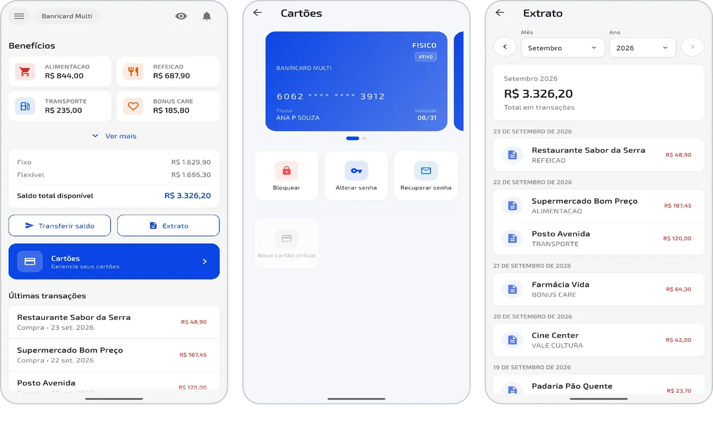
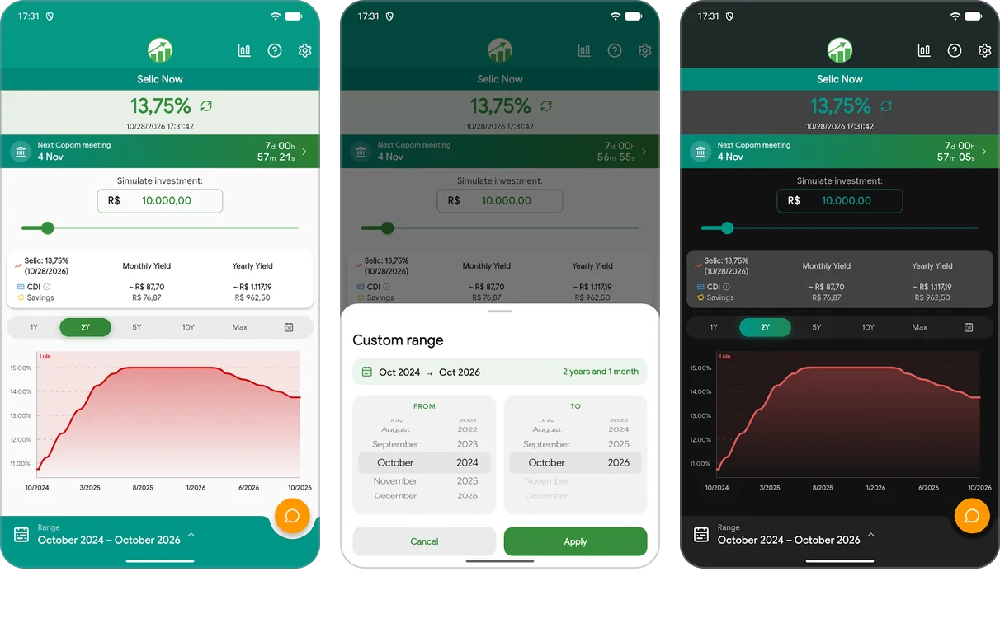
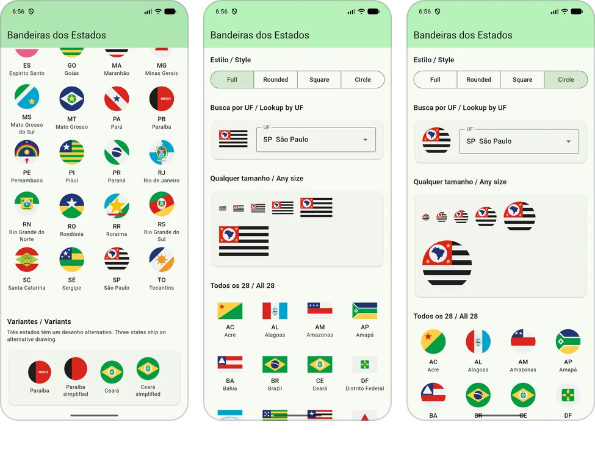
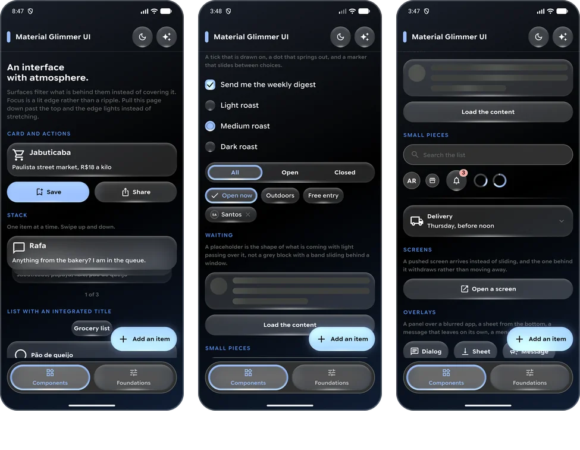
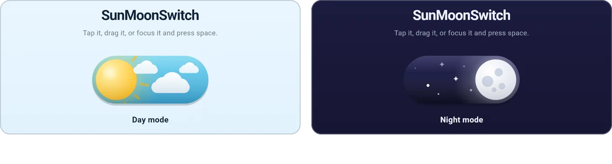

<picture>
  <source media="(prefers-color-scheme: dark)" srcset="assets/banner-dark.svg">
  
</picture>

  <a href="https://www.linkedin.com/in/adrianogba/"><picture><source media="(prefers-color-scheme: dark)" srcset="https://api.iconify.design/simple-icons/linkedin.svg?color=white&height=24"></picture></a>&nbsp;&nbsp;
  <a href="https://facebook.com/adrianogba"><picture><source media="(prefers-color-scheme: dark)" srcset="https://api.iconify.design/simple-icons/facebook.svg?color=white&height=24"></picture></a>&nbsp;&nbsp;
  <a href="mailto:ampontes93@gmail.com"><picture><source media="(prefers-color-scheme: dark)" srcset="https://api.iconify.design/simple-icons/gmail.svg?color=white&height=24"></picture></a>&nbsp;&nbsp;
  <a href="https://wa.me/5583996124792"><picture><source media="(prefers-color-scheme: dark)" srcset="https://api.iconify.design/simple-icons/whatsapp.svg?color=white&height=24"></picture></a>&nbsp;&nbsp;
  <a href="https://adrianogba.is-a.dev"><picture><source media="(prefers-color-scheme: dark)" srcset="https://api.iconify.design/mdi/web.svg?color=white&height=24"></picture></a>&nbsp;&nbsp;
  <a href="https://play.google.com/store/apps/developer?id=Adriano+Pontes"><picture><source media="(prefers-color-scheme: dark)" srcset="https://api.iconify.design/simple-icons/googleplay.svg?color=white&height=24"></picture></a>&nbsp;&nbsp;
  <a href="https://pub.dev/publishers/adrianogba.is-a.dev/packages"><picture><source media="(prefers-color-scheme: dark)" srcset="https://api.iconify.design/simple-icons/dart.svg?color=white&height=24"></picture></a>&nbsp;&nbsp;
  <a href="https://central.sonatype.com/namespace/io.github.adrianogba"><picture><source media="(prefers-color-scheme: dark)" srcset="https://api.iconify.design/simple-icons/apachemaven.svg?color=white&height=24"></picture></a>&nbsp;&nbsp;
  <a href="https://swiftpackageindex.com/Adrianogba"><picture><source media="(prefers-color-scheme: dark)" srcset="https://api.iconify.design/simple-icons/swift.svg?color=white&height=24"></picture></a>

I've been building software professionally since 2016, mostly apps: payments and credit, self-service kiosks, government systems. I usually own a feature all the way through, from the database and backend to the screen the user touches.

Lately that means Flutter, along with native Kotlin and Swift, backend services and the CI/CD and infrastructure around them. I've also managed a team and run technical reviews. My full work history is on [LinkedIn](https://www.linkedin.com/in/adrianogba/).

## Published work

**Banricard Multi** 
[Google Play](https://play.google.com/store/apps/details?id=br.com.sejavero.banricardmulti) · [App Store](https://apps.apple.com/br/app/banricard-multi/id6800410716)

Multi-benefit card app from Banrisul, which I built on my own as a single Flutter codebase for Android and iOS. Wallet balances, statements and physical and virtual card management. 5K+ downloads on Google Play.

 

**Selic Agora** 
[Google Play](https://play.google.com/store/apps/details?id=adrianogba.selic)

Flutter app that tracks Brazil's base interest rate, with an investment simulator, history charts and the Copom calendar. 1K+ downloads on Google Play.

 

**Brazil State Flags** 
[Flutter](https://pub.dev/packages/brazil_state_flags) · [Compose Multiplatform](https://central.sonatype.com/artifact/io.github.adrianogba/brazil-state-flags-compose) · [SwiftUI](https://swiftpackageindex.com/Adrianogba/brazil-state-flags-swift) · [React, Vue and React Native](https://github.com/Adrianogba/brazil-state-flags-js)

All 26 states, the Federal District and Brazil as native vectors, with no image assets and no dependencies.

 

**material_glimmer_ui** 
[pub.dev](https://pub.dev/packages/material_glimmer_ui)

Flutter UI kit of glass surfaces and lit edges, inspired by Jetpack Compose Glimmer and Material Design.

 

**sun_moon_switch** 
[pub.dev](https://pub.dev/packages/sun_moon_switch)

Animated day/night toggle for Flutter, drawn entirely with `CustomPainter`.

 

All three Flutter packages score 160/160 pub points.

## Stack

<picture>
  <source media="(prefers-color-scheme: dark)" srcset="assets/stack-dark.svg">
  
</picture>

**Mobile:** Flutter, Dart, Kotlin, Compose Multiplatform, Android, Swift, SwiftUI 
**Backend:** Go, Spring, PostgreSQL, Firebase 
**Web:** TypeScript, React, Vue 
**Infrastructure:** Docker, GitHub Actions, Grafana, DevSecOps

## Activity

<picture>
  <source media="(prefers-color-scheme: dark)" srcset="assets/stats-dark.svg">
  
</picture>

## Contact

  <a href="https://www.linkedin.com/in/adrianogba/"><picture><source media="(prefers-color-scheme: dark)" srcset="https://api.iconify.design/simple-icons/linkedin.svg?color=white&height=28"></picture></a>&nbsp;&nbsp;
  <a href="https://facebook.com/adrianogba"><picture><source media="(prefers-color-scheme: dark)" srcset="https://api.iconify.design/simple-icons/facebook.svg?color=white&height=28"></picture></a>&nbsp;&nbsp;
  <a href="mailto:ampontes93@gmail.com"><picture><source media="(prefers-color-scheme: dark)" srcset="https://api.iconify.design/simple-icons/gmail.svg?color=white&height=28"></picture></a>&nbsp;&nbsp;
  <a href="https://wa.me/5583996124792"><picture><source media="(prefers-color-scheme: dark)" srcset="https://api.iconify.design/simple-icons/whatsapp.svg?color=white&height=28"></picture></a>

