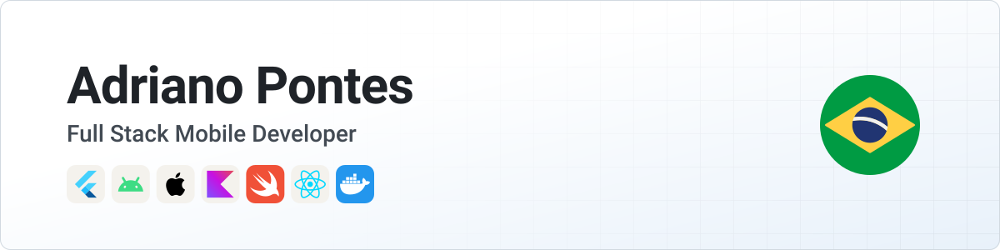
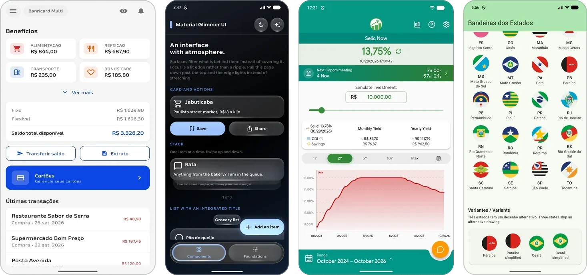

<picture>
  <source media="(prefers-color-scheme: dark)" srcset="assets/banner-dark.svg">
  
</picture>

  <a href="https://www.linkedin.com/in/adrianogba/"><picture><source media="(prefers-color-scheme: dark)" srcset="https://api.iconify.design/simple-icons/linkedin.svg?color=white&height=24"></picture></a>&nbsp;&nbsp;
  <a href="https://facebook.com/adrianogba"><picture><source media="(prefers-color-scheme: dark)" srcset="https://api.iconify.design/simple-icons/facebook.svg?color=white&height=24"></picture></a>&nbsp;&nbsp;
  <a href="mailto:ampontes93@gmail.com"><picture><source media="(prefers-color-scheme: dark)" srcset="https://api.iconify.design/simple-icons/gmail.svg?color=white&height=24"></picture></a>&nbsp;&nbsp;
  <a href="https://wa.me/5583996124792"><picture><source media="(prefers-color-scheme: dark)" srcset="https://api.iconify.design/simple-icons/whatsapp.svg?color=white&height=24"></picture></a>&nbsp;&nbsp;
  <a href="https://adrianogba.is-a.dev"><picture><source media="(prefers-color-scheme: dark)" srcset="https://api.iconify.design/mdi/web.svg?color=white&height=24"></picture></a>&nbsp;&nbsp;
  <a href="https://play.google.com/store/apps/developer?id=Adriano+Pontes"><picture><source media="(prefers-color-scheme: dark)" srcset="https://api.iconify.design/simple-icons/googleplay.svg?color=white&height=24"></picture></a>&nbsp;&nbsp;
  <a href="https://pub.dev/publishers/adrianogba.is-a.dev/packages"><picture><source media="(prefers-color-scheme: dark)" srcset="https://api.iconify.design/simple-icons/dart.svg?color=white&height=24"></picture></a>&nbsp;&nbsp;
  <a href="https://central.sonatype.com/namespace/io.github.adrianogba"><picture><source media="(prefers-color-scheme: dark)" srcset="https://api.iconify.design/simple-icons/apachemaven.svg?color=white&height=24"></picture></a>&nbsp;&nbsp;
  <a href="https://swiftpackageindex.com/Adrianogba"><picture><source media="(prefers-color-scheme: dark)" srcset="https://api.iconify.design/simple-icons/swift.svg?color=white&height=24"></picture></a>

I've been building software professionally since 2016, mostly apps: payments and credit, self-service kiosks, government systems. I usually own a feature all the way through, from the database and backend to the screen the user touches.

Lately that means Flutter, along with native Kotlin and Swift, backend services and the CI/CD and infrastructure around them. I've also managed a team and run technical reviews. My full work history is on [LinkedIn](https://www.linkedin.com/in/adrianogba/).

## Published work

I have apps on Google Play, some of my own, like [Selic Agora](https://play.google.com/store/apps/details?id=adrianogba.selic), and others built for clients such as Banrisul, like Banricard Multi, available on the [Google Play Store](https://play.google.com/store/apps/details?id=br.com.sejavero.banricardmulti) and the [Apple App Store](https://apps.apple.com/br/app/banricard-multi/id6800410716).

I also publish open source libraries:
- **Flutter** on [pub.dev](https://pub.dev/publishers/adrianogba.is-a.dev/packages)
- **Compose Multiplatform** on [Maven Central](https://central.sonatype.com/namespace/io.github.adrianogba)
- **Swift** on the [Swift Package Index](https://swiftpackageindex.com/Adrianogba)
- **React, Vue and React Native** on [GitHub](https://github.com/Adrianogba/brazil-state-flags-js)

## Stack

<picture>
  <source media="(prefers-color-scheme: dark)" srcset="assets/stack-dark.svg">
  
</picture>

**Mobile:** Flutter, Dart, Android, iOS, Kotlin, Compose Multiplatform, Swift, SwiftUI 
**Backend:** Go, Spring, PostgreSQL, Firebase 
**Web:** TypeScript, React, Vue 
**Infrastructure:** Docker, GitHub Actions, Grafana, DevSecOps

## Contact

  <a href="https://www.linkedin.com/in/adrianogba/"><picture><source media="(prefers-color-scheme: dark)" srcset="https://api.iconify.design/simple-icons/linkedin.svg?color=white&height=28"></picture></a>&nbsp;&nbsp;
  <a href="https://facebook.com/adrianogba"><picture><source media="(prefers-color-scheme: dark)" srcset="https://api.iconify.design/simple-icons/facebook.svg?color=white&height=28"></picture></a>&nbsp;&nbsp;
  <a href="mailto:ampontes93@gmail.com"><picture><source media="(prefers-color-scheme: dark)" srcset="https://api.iconify.design/simple-icons/gmail.svg?color=white&height=28"></picture></a>&nbsp;&nbsp;
  <a href="https://wa.me/5583996124792"><picture><source media="(prefers-color-scheme: dark)" srcset="https://api.iconify.design/simple-icons/whatsapp.svg?color=white&height=28"></picture></a>

